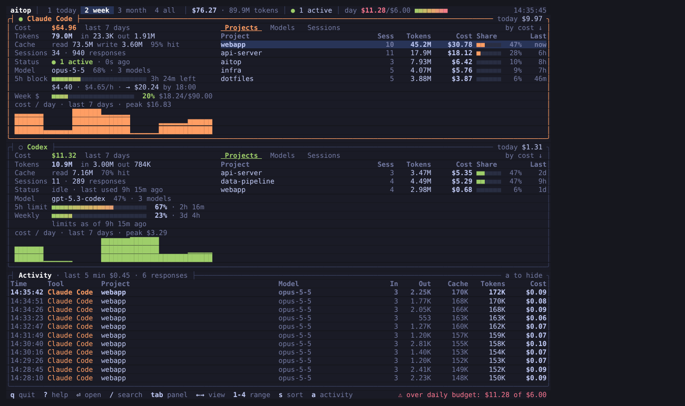
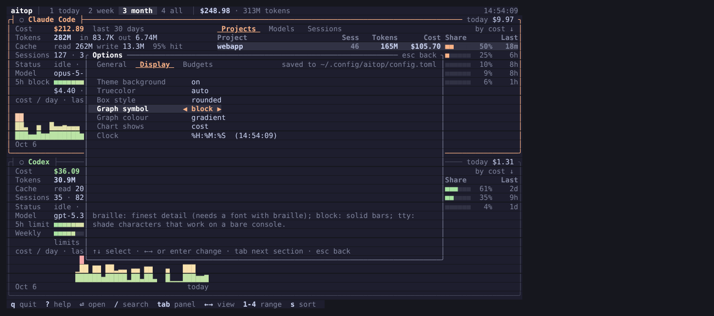

# aitop

**A btop-style terminal dashboard for AI coding tool usage.** See what Claude Code and Codex CLI are costing you, per project, model and session, live, without API keys and without sending anything anywhere.

Inspired by [btop](https://github.com/aristocratos/btop).



<sub>Screenshot generated from `scripts/make-demo-home.py` demo data.</sub>

## Features

- **Both tools, one screen.** Claude Code and OpenAI Codex CLI, each in its own panel, with totals in the header.
- **Live.** Logs are re-read incrementally every 2 s, so a running session shows up as it happens (a 500 MB history scans in under a second, rescans take milliseconds).
- **Costs that match the models you use.** A built-in price table covering Claude 3 → 5.x and GPT-5.x / Codex, including cache reads, 5-minute and 1-hour cache writes, long-context tiers and Claude fast mode. Refresh it any time with `aitop pricing update`.
- **Projects, models, sessions.** Usage is grouped by git repository (subdirectories and worktrees are folded into their repo), by model, or by session, sortable by cost, tokens, recency or name. Press Enter to drill into any row, `/` to search.
- **Limits.** Claude's current 5-hour window with burn rate and projected spend; Codex's 5-hour and weekly rate-limit usage straight from its logs.
- **Budgets.** Set daily, weekly or monthly spend limits, overall or per tool, and get warned as you approach them.
- **Live activity feed.** Every response as it lands: tool, project, model, tokens and cost.
- **Themes and looks.** Eight themes built in (Dracula, Gruvbox, Nord, Catppuccin, Tokyo Night, Solarized Light, your terminal's own colours, and the default) plus your own in TOML; transparent backgrounds; braille, block or TTY graphs; four box styles.
- **Options menu, like btop.** Esc opens Options · Help · Quit; every setting can be changed live and is saved to your config file, comments and all.
- **Status line.** `aitop statusline` puts today's spend, the 5-hour window and budgets in tmux, your prompt or Claude Code's status line.
- **History that outlives the logs.** Claude Code deletes transcripts after 30 days; aitop keeps a compact copy of every usage record in `~/.local/share/aitop/history.jsonl`, so "all time" really means all time.
- **Scriptable.** `aitop report` prints the same numbers as a table or JSON.

## Install

From source (needs Rust 1.86+):

```bash
cargo install --git https://github.com/Zollicoff/aitop
```

Or clone and build:

```bash
git clone https://github.com/Zollicoff/aitop && cd aitop
cargo build --release
./target/release/aitop
```

Works on Linux and macOS.

## Usage

```bash
aitop                      # dashboard
aitop --range week         # start on the 7-day view (today | week | month | all)
aitop report               # usage per project, today
aitop report --range month --by model
aitop report --by day --tool claude --json
aitop statusline           # one-line summary (see "Status line" below)
aitop themes               # list colour themes; --theme NAME to use one
aitop pricing              # every model in your logs and the price applied to it
aitop pricing update       # download current prices
aitop doctor               # where aitop looks, what it found
aitop config > ~/.config/aitop/config.toml   # start a config file
```

### Keys

| Key | Action |
| --- | --- |
| `1` `2` `3` `4` / `[` `]` | range: today · 7 days · 30 days · all time |
| `tab` / `shift-tab` | focus next / previous tool |
| `↑` `↓` / `j` `k`, `PgUp` `PgDn`, `g` `G` | move the selection |
| `←` `→` / `h` `l` (or `p` `m` `S`) | projects · models · sessions |
| `enter` | drill into the selected project, model or session; `esc` / `backspace` back out |
| `/` | search the table as you type; `enter` keeps it, `esc` clears it |
| `s` | sort by cost · tokens · recent · name |
| `z` | zoom the focused tool, with details for the selected row |
| `a` | show / hide the live activity feed |
| `t` / `T` | next / previous theme (for this session; save it in Options) |
| `r` | rescan now |
| `esc` | back out of search / drill-down / zoom; then the menu: Options · Help · Quit |
| `o` / `F2` | Options |
| `?` / `F1` | help, data locations and pricing info |
| `q` | quit |

The mouse works too: click tabs and ranges, scroll tables.

## Where the data comes from

Everything is read from files the tools already write on your machine:

| Tool | Location | What's in it |
| --- | --- | --- |
| Claude Code | `~/.claude/projects/**/*.jsonl` (also `~/.config/claude/projects`, or `$CLAUDE_CONFIG_DIR`) | per-response token usage, model, cwd, session; sub-agent transcripts included |
| Codex CLI | `~/.codex/sessions/**/rollout-*.jsonl` and `archived_sessions` (or `$CODEX_HOME`) | cumulative token counts per session, model, cwd, rate-limit snapshots |

aitop never sends your data anywhere. The only network request it can make is `aitop pricing update`, which downloads the public [LiteLLM price list](https://github.com/BerriAI/litellm/blob/main/model_prices_and_context_window.json).

### How costs are computed

Costs are **estimates at API list prices**. If you use a Claude Pro/Max or ChatGPT subscription, they show what the same usage would cost on the API, not what you are billed. For each response:

```
cost = input × input_price + output × output_price
     + cache_read × cache_read_price
     + cache_write_5m × cache_write_price + cache_write_1h × cache_write_1h_price
```

- Reasoning/thinking tokens are part of output and billed as output.
- Codex reports cumulative totals; aitop bills the difference between consecutive snapshots and does not double-count resumed sessions.
- Claude streams a response as several log lines repeating the same usage; these are de-duplicated on message and request id.
- Prompts over 200K tokens use long-context prices where the model has them; Claude fast mode applies its premium.
- Models without a known price are flagged (`?` / `*` in tables, a warning in the footer). Add them under `[pricing]` in the config, or run `aitop pricing update`.

## Configuration



Most settings can be changed from the dashboard: press `Esc` (or `o`) for **Options**. Use `←` `→` to change a value (Enter to type a number), and `Tab` to move between the General, Display and Budgets sections. Changes apply immediately and are saved to your config file without disturbing its comments or layout.

The file is `~/.config/aitop/config.toml` (all optional; `aitop config` prints a commented example):

```toml
refresh_seconds = 2.0
default_range = "today"     # today | week | month | all
history = true              # keep ~/.local/share/aitop/history.jsonl
active_minutes = 5          # "active" = produced output in the last N minutes
hide_missing = false        # hide the panel of a tool that isn't installed
feed = false                # start with the activity feed open
theme = "aitop"             # see `aitop themes`
theme_background = true     # false: keep the terminal's background (transparency)
truecolor = "auto"          # auto | on | off (256 colours)
box_style = "rounded"       # rounded | plain | double | thick
graph_symbol = "block"      # braille | block | tty
graph_color = "accent"      # accent (tool colour) | gradient (by height)
chart = "cost"              # cost | tokens
clock_format = "%H:%M:%S"   # strftime; "" hides the clock

[budget]                    # USD; see "Budgets" below
daily = 20.0
monthly = 300.0

[paths]                     # override log locations
claude = ["~/.claude/projects"]

[pricing."my-model"]        # USD per million tokens
input = 1.0
output = 4.0
cache_read = 0.1
```

`NO_COLOR` disables colour. With `truecolor = "auto"`, 24-bit colour is used when the terminal advertises it (`COLORTERM`), otherwise the nearest of 256 colours.

### Looks

- **Transparent background:** themes with a background colour paint it everywhere. Set `theme_background = false` (Options → Display → Theme background) to keep your terminal's own background instead, so a transparent or translucent terminal shows through while keeping the theme's other colours.
- **Graphs:** `braille` draws with braille dots for the most detail (needs a font with braille characters, which most have), `block` uses solid bars, and `tty` uses shade characters that work even on a bare Linux console. `graph_color = "gradient"` colours them by height using the theme's gradient, like btop.
- **Boxes:** `rounded`, `plain`, `double` or `thick` borders.

### Themes

`aitop themes` lists the themes with a colour swatch; pick one with `--theme NAME`, `theme = "NAME"` in the config, or cycle with `t` in the dashboard. Built in: `aitop` (default), `catppuccin`, `dracula`, `gruvbox`, `nord`, `solarized-light`, `terminal` (only your terminal's 16 ANSI colours, so it follows your terminal's scheme) and `tokyo-night`.

To make your own, start from an existing one and save it in `~/.config/aitop/themes/`:

```bash
aitop themes show dracula > ~/.config/aitop/themes/mine.toml
```

A theme file only needs the colours it changes; `base` picks the theme it builds on, and a file named after a built-in (e.g. `nord.toml`) tweaks that theme. Colours are `#rrggbb`, ANSI names (`red`, `bright-black`, …), `0`–`255`, or `default` for the terminal's own colour:

```toml
name = "Mine"
base = "dracula"
background = "default"      # keep the terminal's background
claude = "#ff9e64"
gradient = ["#50fa7b", "#f1fa8c", "#ff5555"]   # meters: low, middle, high
```

Keys: `background text bright dim faint border selection good warn bad claude codex gradient`.

### Budgets

```toml
[budget]
daily = 20.0            # across all tools
weekly = 100.0
monthly = 300.0
warn_at = 80            # percent at which a budget turns amber
week_starts = "monday"  # or "sunday"
bell = false            # ring the terminal bell on a budget alert

[budget.claude]         # per-tool budgets
monthly = 200.0
```

Budgets use calendar periods in local time (today, this week, this month). Each tool's panel shows a meter per budget with a projection when the current pace would overshoot; the tightest overall budget sits in the header; the tool's cost turns amber or red; and the footer flashes an alert when a budget crosses into "nearly used" or "used up" (and keeps showing a used-up one). `aitop report` and `aitop statusline` include them too.

## Status line

`aitop statusline` prints one line and exits. It only reads recently changed logs, so it is fast enough to run every few seconds:

```
Claude $4.49 · 5h $0.08 4h 28m | Codex $1.20 · 5h 34% | day 62%
```

Choose what it shows with `--format` (`aitop statusline --fields` lists the placeholders: `{today}`, `{week}`, `{month}`, `{claude}`, `{codex}`, `{block}`, `{block_left}`, `{burn}`, `{codex_5h}`, `{codex_week}`, `{budget}`, `{active}`), and colour it with `--color ansi` or `--color tmux`.

**Claude Code** (`~/.claude/settings.json`):

```json
{ "statusLine": { "type": "command", "command": "aitop statusline --color ansi" } }
```

**tmux** (`~/.tmux.conf`):

```
set -g status-interval 5
set -g status-right '#(aitop statusline --color tmux)'
```

**zsh prompt** (`~/.zshrc`):

```zsh
setopt prompt_subst
RPROMPT='$(aitop statusline --format "{today} today")'
```

## Development

```bash
cargo test
cargo clippy --all-targets -- -D warnings
python3 scripts/make-demo-home.py /tmp/aitop-demo
HOME=/tmp/aitop-demo cargo run -- --no-history
```

### Layout

```
src/
  main.rs          entry point: parse args, dispatch to a command
  cli.rs           command-line definition
  commands/        one module per subcommand (dashboard, report, statusline, pricing, themes, doctor)
  sources/         log readers, one module per tool, behind the `Source` trait
  collector.rs     runs the sources, de-duplicates, prices and stores events
  aggregate/       ranges, per-project/model/session rows, drill-down filters, 5-hour windows
  budget.rs        spend budgets and their periods
  pricing/         price table, cost maths, LiteLLM import
  theme/           palette, theme files, built-in themes (builtin/*.toml), look settings
  ui/              dashboard state, input, drill-down/search, menus/options, and draw/ (one module per region)
  appearance.rs    look-and-feel choices (graph symbols, box styles, …)
  settings.rs      saving single settings back to config.toml
  event.rs  limits.rs  project.rs  store.rs  config.rs  paths.rs  format.rs
```

To add a tool: write a `Source` in `src/sources/`, add a variant to `Tool` in `event.rs`, and register it in `sources::all`; the compiler then points at the couple of `match`es that need an entry (display name, colour). The collector, summaries, reports and dashboard need no changes.

## Credits

The look is inspired by [btop++](https://github.com/aristocratos/btop) by aristocratos. An early aitop prototype was built on btop's code; the current aitop is an independent Rust project that shares no code with it.

## License

Apache-2.0
