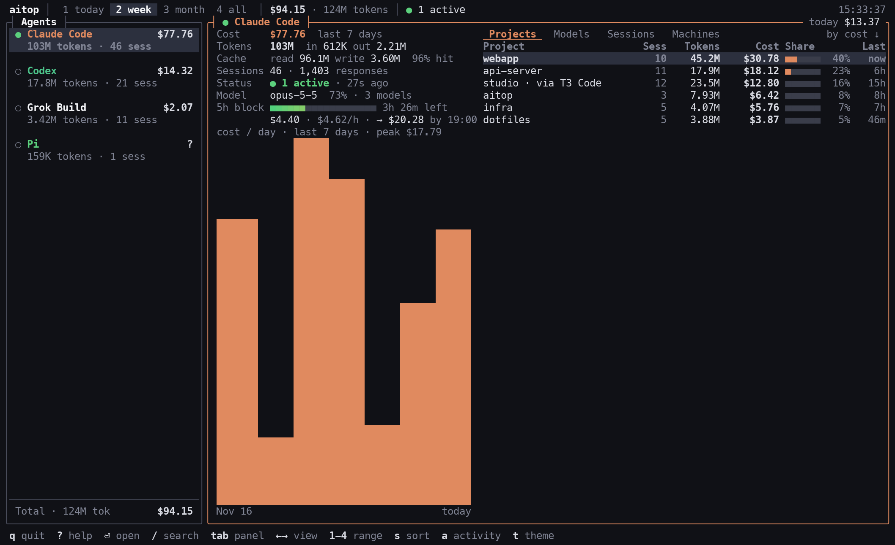
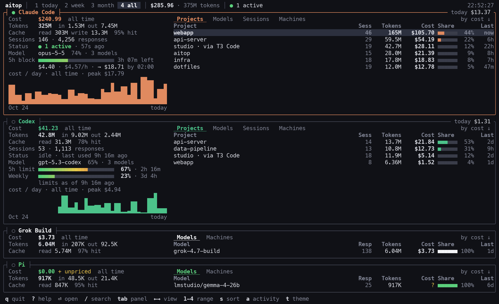
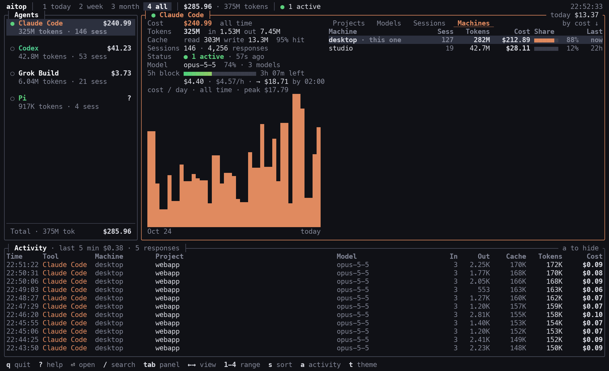
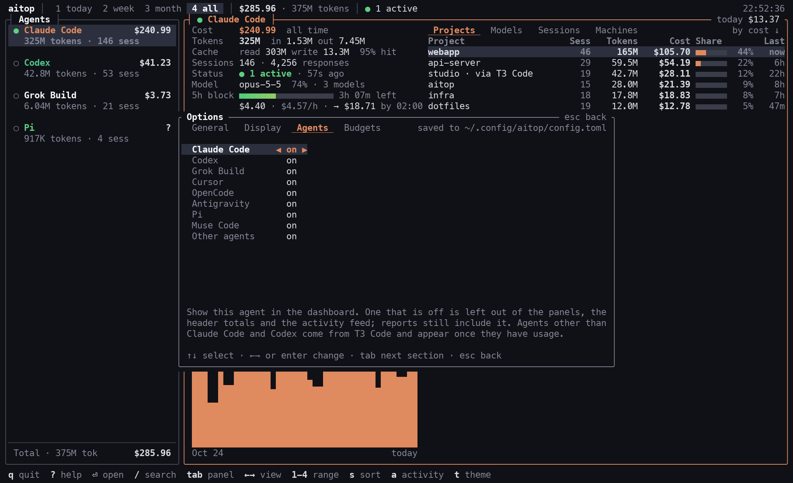
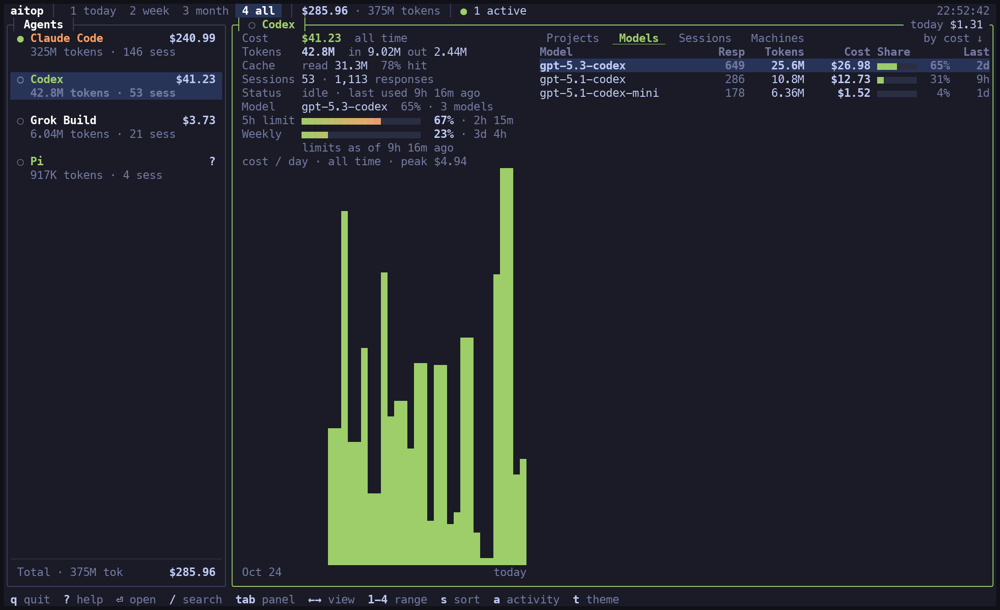

# aitop

**A btop-style terminal dashboard for AI coding tool usage.** See what Claude Code and Codex CLI are costing you, per project, model and session, live, without API keys and without sending anything anywhere. With [T3 Code](https://github.com/pingdotgg/t3code) it also covers your other machines and the other agents T3 runs.

Inspired by [btop](https://github.com/aristocratos/btop).



<sub>The list layout: every agent on the left, the selected one in full.</sub>



<sub>The stacked layout: one panel per agent. `v` switches between the two.</sub>



<sub>Usage per machine, and the live activity feed.</sub>

<sub>All screenshots are of demo data (`scripts/make-demo-home.py`), made with `scripts/make-screenshots.py`.</sub>

## Features

- **Every agent, one screen.** Claude Code and OpenAI Codex CLI are read from their own logs, in full detail. Each has its own panel, with totals in the header.
- **Live.** Logs are re-read incrementally every 2 s, so a running session shows up as it happens (a 500 MB history scans in under a second, rescans take milliseconds).
- **Costs that match the models you use.** A built-in price table covering Claude 3 → 5.x and GPT-5.x / Codex, including cache reads, 5-minute and 1-hour cache writes, long-context tiers, Claude fast mode and Codex's faster speed tiers. Refresh it any time with `aitop pricing update`; with T3 Code installed it stays current by itself.
- **Projects, models, sessions.** Usage is grouped by git repository (subdirectories and worktrees are folded into their repo), by model, or by session, sortable by cost, tokens, recency or name. Press Enter to drill into any row, `/` to search.
- **Limits.** Claude's current 5-hour window with burn rate and projected spend; Codex's 5-hour and weekly rate-limit usage straight from its logs.
- **Budgets.** Set daily, weekly or monthly spend limits, overall or per tool, and get warned as you approach them.
- **Live activity feed.** Every response as it lands: agent, project, model, tokens and cost.
- **Themes and looks.** Eight themes built in (Dracula, Gruvbox, Nord, Catppuccin, Tokyo Night, Solarized Light, your terminal's own colours, and the default) plus your own in TOML; transparent backgrounds; braille, block or TTY graphs; four box styles.
- **Two layouts, your choice of agents.** A list of agents beside the selected one in full, or stacked panels; turn each agent on or off in Options.
- **Options menu, like btop.** Esc opens Options · Help · Quit; every setting can be changed live and is saved to your config file, comments and all.
- **Status line.** `aitop statusline` puts today's spend, the 5-hour window and budgets in tmux, your prompt or Claude Code's status line.
- **History that outlives the logs.** Claude Code deletes transcripts after 30 days; aitop keeps a compact copy of every usage record in `~/.local/share/aitop/history.jsonl`, so "all time" really means all time.
- **Works with T3 Code, no setup.** If [T3 Code](https://github.com/pingdotgg/t3code) is running, aitop finds the transcript folders it uses, shows the machines you have linked in it, and adds the other agents T3 tracks (Grok, Cursor, Pi, OpenCode, Antigravity, …).
- **All your machines.** Usage from your other machines, per machine, through T3 Code's linked environments or over ssh. A response that two machines can see is counted once.
- **Scriptable.** `aitop report` prints the same numbers as a table or JSON.

## Install

From source (needs Rust 1.86+):

```bash
cargo install --git https://github.com/Zollicoff/aitop
```

Or clone and build:

```bash
git clone https://github.com/Zollicoff/aitop && cd aitop
cargo build --release
./target/release/aitop
```

Works on Linux and macOS.

## Usage

```bash
aitop                      # dashboard
aitop --range week         # start on the 7-day view (today | week | month | all)
aitop report               # usage per project, today
aitop report --range month --by model
aitop report --by day --tool claude --json
aitop report --tool grok   # one agent: claude, codex, grok, cursor, opencode, antigravity, pi, muse
aitop statusline           # one-line summary (see "Status line" below)
aitop themes               # list colour themes; --theme NAME to use one
aitop pricing              # every model in your logs and the price applied to it
aitop pricing update       # download current prices
aitop report --by machine  # usage per machine (see "Several machines" below)
aitop sync                 # read your other machines now (T3 Code links and [[remote]]s)
aitop doctor               # where aitop looks, what it found
aitop config > ~/.config/aitop/config.toml   # start a config file
```

### Keys

| Key | Action |
| --- | --- |
| `1` `2` `3` `4` / `[` `]` | range: today · 7 days · 30 days · all time |
| `tab` / `shift-tab` | focus next / previous agent |
| `v` | switch layout: agent list + detail · stacked panels |
| `↑` `↓` / `j` `k`, `PgUp` `PgDn`, `g` `G` | move the selection |
| `←` `→` / `h` `l` (or `p` `m` `S`) | next / previous tab: projects · models · sessions |
| `M` | machines, when there is usage from more than one |
| `enter` | drill into the selected project, model, session or machine; `esc` / `backspace` back out |
| `/` | search the table as you type; `enter` keeps it, `esc` clears it |
| `s` | sort by cost · tokens · recent · name |
| `z` | zoom the focused agent to the full screen, with details for the selected row |
| `a` | show / hide the live activity feed |
| `t` / `T` | next / previous theme (for this session; save it in Options) |
| `r` | rescan now |
| `esc` | back out of search / drill-down / zoom; then the menu: Options · Help · Quit |
| `o` / `F2` | Options |
| `?` / `F1` | help, data locations and pricing info |
| `q` | quit |

The mouse works too: click tabs and ranges, scroll tables.

## Where the data comes from

Claude Code and Codex are read from the files they already write on your machine. Other agents are known through T3 Code:

| Tool | Location | What's in it |
| --- | --- | --- |
| Claude Code | `~/.claude/projects/**/*.jsonl` (also `~/.config/claude/projects`, or `$CLAUDE_CONFIG_DIR`) | per-response token usage, model, cwd, session; sub-agent transcripts included |
| Codex CLI | `~/.codex/sessions/**/rollout-*.jsonl` and `archived_sessions` (or `$CODEX_HOME`), including the `.jsonl.zst` files Codex compresses older sessions into | each request's token usage and the session's running total, model, speed tier, cwd, rate-limit snapshots |
| Other agents (Grok, Cursor, Pi, …) | [T3 Code](#t3-code), when it is running | daily totals and cost per agent and model |

aitop never sends your data anywhere. `aitop pricing update` downloads the public [LiteLLM price list](https://github.com/BerriAI/litellm/blob/main/model_prices_and_context_window.json). Beyond that it only talks to your own machines, to read their usage: the T3 Code server on this one and the machines linked in it (see [T3 Code](#t3-code)), and any you list under `[[remote]]`, over `ssh` (see [Several machines](#several-machines)).

### How costs are computed

Costs are **estimates at API list prices**. If you use a Claude Pro/Max or ChatGPT subscription, they show what the same usage would cost on the API, not what you are billed. For each response:

```
cost = input × input_price + output × output_price
     + cache_read × cache_read_price
     + cache_write_5m × cache_write_price + cache_write_1h × cache_write_1h_price
```

- Reasoning/thinking tokens are part of output and billed as output.
- Codex logs each request's usage next to the session's running total; aitop bills each request once and uses the total to check it. History that a forked session or sub-agent copies from its parent is not billed again, and neither is a resumed or copied log. (These are the rules T3 Code's own reader follows, so the two agree.)
- Claude streams a response as several log lines repeating the same usage; these are de-duplicated on message and request id.
- Long prompts use long-context prices where the model has them (over 200K tokens, or the threshold the price list gives). Claude fast mode applies its premium, and Codex requests made at the fast ("priority") or ultrafast speed tier are charged that tier's prices.
- Models without a known price are flagged (`?` / `*` in tables, a warning in the footer). Add them under `[pricing]` in the config, or run `aitop pricing update`.

Prices come from, later ones winning: the table built into aitop, one downloaded with `aitop pricing update`, the price list [T3 Code](#t3-code) keeps on this machine if it is installed, and `[pricing]` in the config. `aitop pricing` shows which price each model in your logs got, and `aitop doctor` which lists are in use.

## T3 Code

[T3 Code](https://github.com/pingdotgg/t3code) runs Claude Code and Codex for you, often with config folders of its own, and can link your machines together. When it is installed and running, aitop uses it with nothing to set up:

- **Its transcript folders.** aitop asks T3 which folders it keeps Claude Code and Codex transcripts in on this machine and reads those as well, so usage from T3's own config folders is counted without listing them under `[paths]`. (Folders you do set under `[paths]` are used as they are.)
- **Its linked machines.** Every machine linked in T3 (Settings → Environments → Linked environments) shows up under **Machines**, with its usage per agent, model and day.
- **Its other agents.** aitop reads Claude Code's and Codex's logs itself. Every other agent T3 tracks (Grok Build, Cursor, OpenCode, Antigravity, Pi, Muse Code) gets a panel of its own, under its own name, once there is any usage of it on this machine or a linked one. Its tabs are Models and Machines, and its numbers are T3's daily totals and costs. An agent T3 adds later that this aitop does not know by name appears under "Other agents".

What a linked machine shows is what T3 shares: totals, not individual responses. So it has cost, tokens, models and the daily chart, but no projects or sessions (it appears as one row, "*name* · via T3 Code"), and it is left out of the activity feed, the "active" count and the 5-hour window. Its cost is the one T3 reports, worked out on that machine response by response. For full detail from another machine, read it over ssh instead (next section); a machine read both ways is only counted once.

How aitop gets access, so you know what it does:

- On this machine it runs T3's own `t3 auth session issue` to give itself a session that can only read usage and the list of links. The token is kept in `~/.local/share/aitop/t3.json`, readable only by you.
- For a linked machine it asks the local T3 server to pair it. That needs a session allowed to manage access, which aitop creates for five minutes and revokes as soon as the pairing is done. The session it ends up with on the linked machine can only read usage.
- Every session is listed in T3 under **Settings → Sharing & access** as `aitop`, where you can revoke it. `[t3] enabled = false` in the config makes aitop leave T3 alone entirely.

**If aitop and T3's Usage page disagree.** They read the same logs by the same rules, with one difference: aitop also reads Codex's `archived_sessions` folder. T3 does not, so of the sessions you have archived it only counts what it had already read before they were moved. aitop counts them all, and so can show more Codex usage than T3 does.

**Prices.** T3 keeps a current price list on each machine (LiteLLM's, which it refreshes by itself). aitop uses that list for this machine's usage, so new models are priced without running `aitop pricing update` and costs line up with T3's own Usage page; `[pricing]` in the config still wins. For linked machines aitop keeps the cost T3 reports. `[t3] prices = false` goes back to aitop's own prices for both.

Requirements for linked machines: a T3 Code from 21 November 2026 or later on both machines, T3's **Linked environments** turned on, a full-access link, and T3 running on each. A machine that is asleep keeps showing what it last reported; help (`?`) and `aitop sync` say why one could not be read.

## Several machines

Machines linked in T3 Code appear by themselves (above). To read a machine in full detail, or without T3, aitop can also fetch its records over ssh. On the machine where you watch the dashboard, list the others in the config:

```toml
# What this machine is called (default: its hostname).
host = "desktop"

[[remote]]
ssh = "macbook"        # a host, ssh alias or user@host
# name = "macbook"     # what to call it (default: the ssh host)
# aitop = "/usr/local/bin/aitop"   # if aitop is not on the PATH there
# every = 60           # seconds between syncs
```

Each remote needs aitop 2.2 or newer installed and has to be reachable with `ssh` without a password prompt. Nothing has to be running on it: every `every` seconds the dashboard runs `aitop export` there, which prints that machine's usage records, and merges them in.

- **Per machine.** A **Machines** tab (`M`) appears in each panel; Enter drills into one machine's projects, models and sessions. The activity feed gains a machine column, and `aitop report` takes `--by machine` and `--machine NAME`.
- **Counted once.** Records keep their ids across machines, so a response that two machines can both see (a synced transcript folder, for instance) is counted once, under the machine that had it first. A machine read over ssh is no longer also taken from T3 Code.
- **Kept while a machine is away.** What a remote reports is stored in the local history, so a machine that is asleep still shows what it last sent. Help (`?`) shows when each one last synced and why a sync failed; `aitop sync` pulls from all of them once and prints the result, which is also the way to keep `aitop report` current from cron.
- **Everything is totalled.** Header totals, the 5-hour window and budgets cover all machines. `aitop statusline` reads only this machine's recent logs.
- **Not only ssh.** `command = ["docker", "exec", "box", "aitop"]` (with a `name`) runs aitop some other way; `export` and its flags are added to it.

Costs for remote usage are computed here, with this machine's price table.

## Configuration



Most settings can be changed from the dashboard: press `Esc` (or `o`) for **Options**. Use `←` `→` to change a value (Enter to type a number), and `Tab` to move between the General, Display, Agents and Budgets sections. Changes apply immediately and are saved to your config file without disturbing its comments or layout.

The file is `~/.config/aitop/config.toml` (all optional; `aitop config` prints a commented example):

```toml
refresh_seconds = 2.0
default_range = "today"     # today | week | month | all
history = true              # keep ~/.local/share/aitop/history.jsonl
active_minutes = 5          # "active" = produced output in the last N minutes
hide_missing = false        # hide the panel of a tool that isn't installed
feed = false                # start with the activity feed open
theme = "aitop"             # see `aitop themes`
theme_background = true     # false: keep the terminal's background (transparency)
truecolor = "auto"          # auto | on | off (256 colours)
box_style = "rounded"       # rounded | plain | double | thick
graph_symbol = "block"      # braille | block | tty
graph_color = "accent"      # accent (tool colour) | gradient (by height)
chart = "cost"              # cost | tokens
layout = "auto"             # auto | list | stacked (see "Layout and agents" below)
clock_format = "%H:%M:%S"   # strftime; "" hides the clock

[budget]                    # USD; see "Budgets" below
daily = 20.0
monthly = 300.0

[agents]                    # false hides an agent from the dashboard
pi = false

[t3]                        # T3 Code (see "T3 Code" above)
enabled = true
prices = true

[paths]                     # override log locations
claude = ["~/.claude/projects"]

[pricing."my-model"]        # USD per million tokens
input = 1.0
output = 4.0
cache_read = 0.1
```

`NO_COLOR` disables colour. With `truecolor = "auto"`, 24-bit colour is used when the terminal advertises it (`COLORTERM`), otherwise the nearest of 256 colours.

### Layout and agents

- **Two layouts.** `list` puts every agent in a list on the left, with its cost, and shows the selected one in full beside it; `tab` picks the agent. `stacked` gives each agent a full-width panel, top to bottom. The default, `auto`, is stacked for one or two agents and the list for more. `v` switches while aitop runs; Options → Display → Layout (or `layout = "list"`) keeps your choice.
- **Choose which agents are shown.** Options → Agents has an on/off switch for each one, saved as `[agents]` in the config (`pi = false`). An agent that is off is left out of the panels, the header totals and the activity feed; `aitop report` still includes it.

### Looks

- **Transparent background:** themes with a background colour paint it everywhere. Set `theme_background = false` (Options → Display → Theme background) to keep your terminal's own background instead, so a transparent or translucent terminal shows through while keeping the theme's other colours.
- **Graphs:** `braille` draws with braille dots for the most detail (needs a font with braille characters, which most have), `block` uses solid bars, and `tty` uses shade characters that work even on a bare Linux console. `graph_color = "gradient"` colours them by height using the theme's gradient, like btop.
- **Boxes:** `rounded`, `plain`, `double` or `thick` borders.

### Themes



`aitop themes` lists the themes with a colour swatch; pick one with `--theme NAME`, `theme = "NAME"` in the config, or cycle with `t` in the dashboard. Built in: `aitop` (default), `catppuccin`, `dracula`, `gruvbox`, `nord`, `solarized-light`, `terminal` (only your terminal's 16 ANSI colours, so it follows your terminal's scheme) and `tokyo-night`.

To make your own, start from an existing one and save it in `~/.config/aitop/themes/`:

```bash
aitop themes show dracula > ~/.config/aitop/themes/mine.toml
```

A theme file only needs the colours it changes; `base` picks the theme it builds on, and a file named after a built-in (e.g. `nord.toml`) tweaks that theme. Colours are `#rrggbb`, ANSI names (`red`, `bright-black`, …), `0`–`255`, or `default` for the terminal's own colour:

```toml
name = "Mine"
base = "dracula"
background = "default"      # keep the terminal's background
claude = "#ff9e64"
gradient = ["#50fa7b", "#f1fa8c", "#ff5555"]   # meters: low, middle, high
```

Keys: `background text bright dim faint border selection good warn bad claude codex gradient`. The other agents' panels take their colours from these (Grok Build `bright`, Pi `good`, Muse Code `warn`, and Cursor, OpenCode and Antigravity the three `gradient` colours), so every theme covers them.

### Budgets

```toml
[budget]
daily = 20.0            # across all tools
weekly = 100.0
monthly = 300.0
warn_at = 80            # percent at which a budget turns amber
week_starts = "monday"  # or "sunday"
bell = false            # ring the terminal bell on a budget alert

[budget.claude]         # for one tool: [budget.claude] or [budget.codex]
monthly = 200.0
```

Budgets use calendar periods in local time (today, this week, this month). Each tool's panel shows a meter per budget with a projection when the current pace would overshoot; the tightest overall budget sits in the header; the tool's cost turns amber or red; and the footer flashes an alert when a budget crosses into "nearly used" or "used up" (and keeps showing a used-up one). `aitop report` and `aitop statusline` include them too.

## Status line

`aitop statusline` prints one line and exits. It only reads recently changed logs, so it is fast enough to run every few seconds:

```
Claude $4.49 · 5h $0.08 4h 28m | Codex $1.20 · 5h 34% | day 62%
```

Choose what it shows with `--format` (`aitop statusline --fields` lists the placeholders: `{today}`, `{week}`, `{month}`, `{claude}`, `{codex}`, `{block}`, `{block_left}`, `{burn}`, `{codex_5h}`, `{codex_week}`, `{budget}`, `{active}`), and colour it with `--color ansi` or `--color tmux`.

**Claude Code** (`~/.claude/settings.json`):

```json
{ "statusLine": { "type": "command", "command": "aitop statusline --color ansi" } }
```

**tmux** (`~/.tmux.conf`):

```
set -g status-interval 5
set -g status-right '#(aitop statusline --color tmux)'
```

**zsh prompt** (`~/.zshrc`):

```zsh
setopt prompt_subst
RPROMPT='$(aitop statusline --format "{today} today")'
```

## Development

```bash
cargo test
cargo clippy --all-targets -- -D warnings
python3 scripts/make-demo-home.py /tmp/aitop-demo
HOME=/tmp/aitop-demo T3CODE_HOME=/tmp/aitop-demo/.t3 cargo run
python3 scripts/make-screenshots.py     # redo docs/*.png (needs pyte and pillow)
```

The demo home has logs for Claude Code and Codex, and a history file with what T3 Code would have reported (two other agents and a linked machine), so every panel and layout can be tried without real data. `T3CODE_HOME` keeps a real T3 Code on your machine out of it.

### Layout

```
src/
  main.rs          entry point: parse args, dispatch to a command
  cli.rs           command-line definition
  commands/        one module per subcommand (dashboard, report, statusline, pricing, themes, doctor, sync, export)
  sources/         log readers behind the `Source` trait: claude.rs, and codex/ (its counters,
                   the billing rules, compressed logs)
  collector/       runs the sources, de-duplicates, prices and stores events (mod.rs); usage from
                   other machines and T3 Code, and what is counted once (machines.rs); what is
                   published to the dashboard (dataset.rs)
  remote.rs        usage from other machines over ssh: runs `aitop export` there and parses it
  t3/              T3 Code: finding it and getting access (install.rs), what is remembered between
                   runs (state.rs), its WebSocket RPC (rpc.rs), reading it (client.rs), its usage
                   summaries (usage.rs), and turning daily totals into records (records.rs)
  aggregate/       ranges, per-project/model/session/machine rows, drill-down filters, 5-hour windows
  budget.rs        spend budgets and their periods
  pricing/         price table, cost maths, LiteLLM import
  theme/           palette, theme files, built-in themes (builtin/*.toml), look settings
  ui/              dashboard state, input, drill-down/search, menu/ (the menus, and the table of
                   settings in items.rs), and draw/ (one module per region)
  appearance.rs    look-and-feel choices (graph symbols, box styles, …)
  settings.rs      saving single settings back to config.toml
  event.rs  limits.rs  project.rs  store.rs  config.rs  paths.rs  format.rs  host.rs
```

To add a tool aitop reads itself: write a `Source` in `src/sources/`, add a variant to `Tool` in `event.rs`, and register it in `sources::all`; the compiler then points at the couple of `match`es that need an entry (display name, colour). To name an agent that T3 Code reports: add the variant to `Tool` with T3's name for it as its `key`, and a line for its switch in `ui/menu/items.rs`. The collector, summaries, reports and dashboard need no changes for either.

## Credits

The look is inspired by [btop++](https://github.com/aristocratos/btop) by aristocratos. An early aitop prototype was built on btop's code; the current aitop is an independent Rust project that shares no code with it.

## License

Apache-2.0
